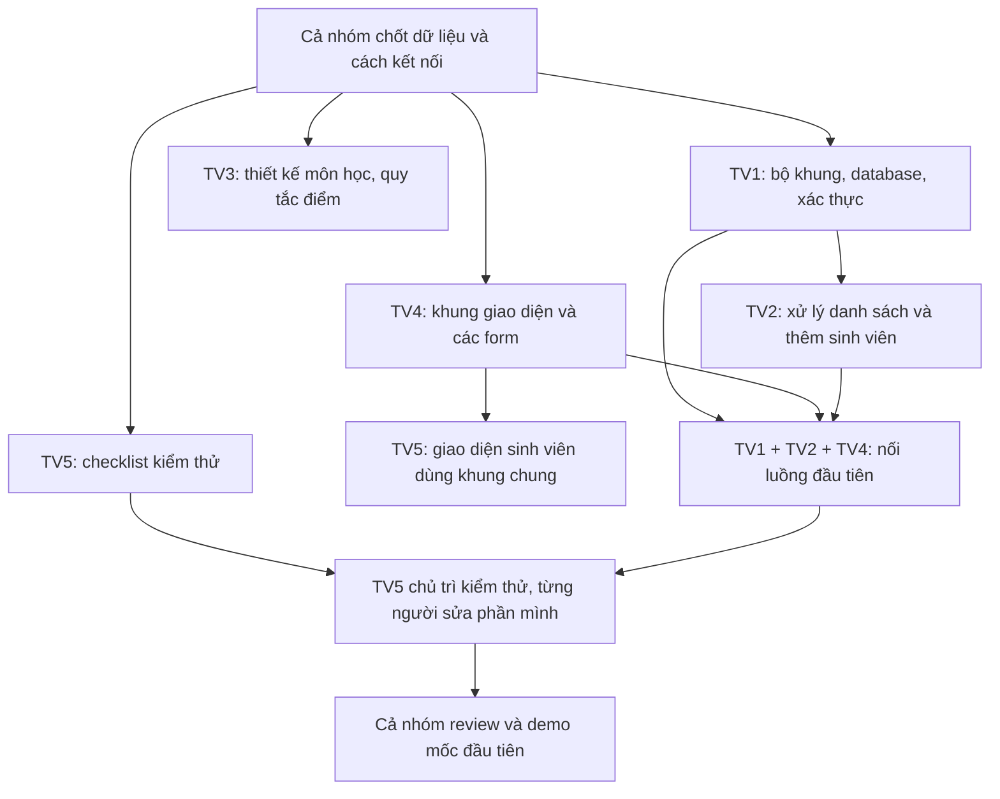

# Thứ tự bắt đầu và cách phối hợp nhóm

Tài liệu này chuyển [bản phân công](work-assignment-and-technology.md) thành các bước thực hiện cụ thể, dựa trên [đặc tả](dacTa.md). Số thành viên 1–5 tương ứng với bản phân công; nhóm điền tên người nhận khi giao task.

Đây là kế hoạch hướng dẫn, không phải xác nhận các chức năng đã được xây dựng. Flask và SQLite được nhắc theo bản công nghệ hiện tại; cả nhóm cần xác nhận lựa chọn trước khi triển khai backend.

## 1. Mục tiêu đầu tiên

Hoàn thành một luồng nhỏ chạy từ đầu đến cuối:

**Giáo viên đăng nhập → xem danh sách sinh viên K10TIN → thêm sinh viên → thấy dữ liệu mới trong danh sách.**

Luồng này giúp nhóm tập nối giao diện, xử lý Python và database trước khi làm điểm. Giao diện đã vẽ xong hoặc hàm Python chạy riêng mới là hoàn thành một phần; cần nối chúng và kiểm tra thao tác thực tế.

| Phần | Làm gì trong luồng này? | Phụ trách |
|---|---|---|
| Giao diện (frontend) | Hiển thị trang đăng nhập, bảng sinh viên, form và thông báo | Thành viên 4 |
| Xác thực | Kiểm tra tài khoản và ghi nhận người đang đăng nhập | Thành viên 1 |
| Xử lý sinh viên (backend) | Lấy danh sách, kiểm tra dữ liệu và lưu sinh viên | Thành viên 2 |
| Database | Lưu tài khoản, lớp và sinh viên | Thành viên 1 thiết kế, thành viên 2 sử dụng |
| Kiểm thử toàn luồng | Thử thao tác hợp lệ, sai dữ liệu và sai quyền | Thành viên 5 chủ trì |

Thành viên 3 song song chuẩn bị phần môn học và điểm, đồng thời review xác thực theo bản phân công.

## 2. Buổi đầu tiên: thống nhất trước khi code

Thành viên 1 chủ trì, cả nhóm cùng quyết định và ghi lại kết quả trong tài liệu liên quan.

- Xác nhận phạm vi một lớp K10TIN, một học kỳ và hai vai trò giáo viên/sinh viên.
- Liệt kê màn hình cần có, phác thảo vị trí menu, bảng, form và thông báo.
- Chốt trường dữ liệu sinh viên, trường bắt buộc, quy tắc kiểm tra và liên kết với lớp, tài khoản.
- Xác định cách cấp tài khoản và liên kết tài khoản với giáo viên/sinh viên.
- Thống nhất tên trường dùng chung giữa HTML, Python và database.
- Xác nhận stack, cách chạy dự án, cách chia nhánh và người review.
- Giao người chuẩn bị công thức điểm, cách làm tròn, xử lý thiếu điểm, ngưỡng xếp loại và đồng hạng. Các quy tắc này phải được chốt trước khi triển khai tính điểm.

Ví dụ: nếu mã sinh viên được đặt là `student_code`, người làm form và người xử lý Python phải thống nhất cách gửi/nhận trường đó. Đây là ví dụ tên gọi, chưa phải schema chính thức.

**Kết quả buổi họp:** có người nhận từng task, phác thảo giao diện, dữ liệu ban đầu và các quyết định còn chờ chốt. Không cần hoàn thiện mọi chi tiết giao diện mới bắt đầu làm.

## 3. Việc đầu tiên của từng thành viên

### Thành viên 1 — Dựng nền tảng chung

1. Dựng bộ khung Flask theo lựa chọn đã được nhóm xác nhận.
2. Viết hướng dẫn cài đặt và chạy, danh sách thư viện và cấu hình mẫu không chứa secret.
3. Thiết kế database; nhờ thành viên 2 và 3 review các bảng, khóa và liên kết.
4. Viết script tạo database và dữ liệu giả để từng bạn dựng trên máy riêng.
5. Làm đăng nhập, đăng xuất, session và cơ chế kiểm tra vai trò.
6. Gửi phần nền tảng chạy được để review và ghép vào `develop` sớm.

**Bàn giao:** mọi người chạy được cùng dự án, dựng được database riêng và đăng nhập được bằng tài khoản demo. Không chia sẻ file database đang dùng để thay cho script khởi tạo.

Người 1 cung cấp cơ chế kiểm tra quyền; người 2 và 3 phải áp dụng nó trong từng chức năng của mình.

### Thành viên 2 — Danh sách và thêm sinh viên

1. Thống nhất bảng lớp/sinh viên/giáo viên với thành viên 1.
2. Làm hàm lấy danh sách sinh viên lớp K10TIN.
3. Làm xử lý thêm sinh viên, kiểm tra trường bắt buộc, định dạng và trùng mã.
4. Kiểm tra đăng nhập, quyền giáo viên và lớp hợp lệ trước khi lưu.
5. Thống nhất với thành viên 4 cách form gửi dữ liệu và hiển thị kết quả.
6. Kiểm thử dữ liệu hợp lệ, không hợp lệ và truy cập sai quyền.

**Bàn giao:** backend đọc/lưu được sinh viên và cung cấp thông báo lỗi phù hợp cho giao diện.

### Thành viên 3 — Chuẩn bị môn học và quy tắc điểm

1. Review database cùng thành viên 1, đặc biệt quan hệ sinh viên–môn–học kỳ–điểm.
2. Chuẩn bị cấu trúc môn học và phân công giảng dạy.
3. Đề xuất các quy tắc tính điểm để cả nhóm xác nhận, kèm ví dụ đầu vào và kết quả mong đợi.
4. Review phần xác thực/phân quyền của thành viên 1.
5. Khi bộ khung chung sẵn sàng, triển khai quản lý môn học và phân công trước khi nhập điểm.

**Bàn giao:** thiết kế phần học tập đã thống nhất, quy tắc tính có ví dụ kiểm tra và các task tiếp theo rõ ràng. Không tự chọn tỷ lệ điểm hoặc ngưỡng xếp loại khi chưa có quyết định chung.

### Thành viên 4 — Giao diện cho luồng đầu tiên

1. Làm khung chung, menu, bảng, nút, form và thông báo theo `style.md`.
2. Làm trang đăng nhập, danh sách sinh viên và form thêm sinh viên.
3. Khi backend chưa sẵn sàng, dùng dữ liệu giả để dựng giao diện.
4. Nối form đăng nhập với người 1, danh sách/form sinh viên với người 2.
5. Kiểm tra trạng thái danh sách rỗng, lỗi nhập liệu, thành công và trạng thái đang gửi khi phù hợp.
6. Kiểm tra mobile, desktop và bàn phím; bàn giao khung dùng chung cho thành viên 5.

**Bàn giao:** giáo viên thao tác được trên màn hình và nhìn thấy kết quả từ backend.

### Thành viên 5 — Giao diện sinh viên và chuẩn bị kiểm thử

1. Thống nhất với người 4 cách dùng chung layout, bảng và thông báo.
2. Dựng trang thông tin cá nhân sinh viên bằng dữ liệu giả trong lúc chờ backend.
3. Viết checklist kiểm tra luồng đăng nhập → danh sách → thêm sinh viên.
4. Khi các phần đã nối, chạy kiểm thử, ghi lỗi và người phụ trách sửa.
5. Kiểm tra lại lỗi sau khi sửa; chuẩn bị kịch bản demo luồng đầu tiên.

**Bàn giao:** trang sinh viên ban đầu, checklist và kết quả kiểm thử tích hợp. Mỗi thành viên vẫn phải tự kiểm tra phần mình trước khi bàn giao.

## 4. Task nào chờ task nào?

Mũi tên thể hiện đầu vào cần để hoàn thiện phần sau. Trong lúc chờ, frontend có thể dựng bằng dữ liệu giả, backend có thể chuẩn bị logic và test theo cấu trúc đã thống nhất.

## 5. Cách nối giao diện với backend

Trước khi viết một chức năng, người frontend và backend thống nhất những nội dung sau. Ví dụ minh họa cho thêm sinh viên:

| Nội dung | Thỏa thuận cần có |
|---|---|
| Mở form | Đường dẫn và template hiển thị form |
| Gửi form | Ví dụ `POST /students/create`; nhóm chốt đường dẫn thực tế trước khi code |
| Dữ liệu gửi | Tên trường, kiểu dữ liệu, trường bắt buộc và giá trị lớp |
| Quyền | Backend chỉ cho giáo viên thực hiện; ẩn nút trên giao diện chưa đủ |
| Nhập sai | Trả thông báo rõ ràng, giữ dữ liệu phù hợp để sửa |
| Thành công | Quay về danh sách, hiện thông báo và thấy sinh viên mới |
| Bảo vệ form | Có kiểm tra CSRF cho thao tác thay đổi dữ liệu dùng session/cookie |

Theo kiến trúc trong bản phân công, Flask có thể nhận form rồi render HTML trực tiếp. Nhóm chưa cần xây REST API riêng cho luồng này.

## 6. Danh sách task cho mốc đầu tiên

Các mã dưới đây dùng để trao đổi và có thể đưa lên GitHub Issues. Đây là danh sách đề xuất, chưa phải các issue đã được tạo.

| Mã | Task | Người chính | Review | Phụ thuộc | Điều kiện hoàn thành |
|---|---|---|---|---|---|
| START-01 | Thống nhất phạm vi, dữ liệu và màn hình | TV1 | Cả nhóm | Không | Có quyết định và người nhận task |
| START-02 | Dựng bộ khung và hướng dẫn chạy | TV1 | TV3 | START-01 | Các thành viên chạy được cùng dự án |
| START-03 | Script database và dữ liệu giả | TV1 | TV2, TV3 | START-01, START-02 | Tạo được database mới từ script |
| START-04 | Đăng nhập, đăng xuất và kiểm tra vai trò | TV1 | TV3 | START-03 | Đúng/sai tài khoản và sai quyền được xử lý |
| START-05 | Khung giao diện và trang đăng nhập | TV4 | TV2, TV5 | START-01 | Giao diện dùng được; nối đăng nhập khi START-04 sẵn sàng |
| START-06 | Backend danh sách và thêm sinh viên | TV2 | TV1, TV4 | START-03, START-04 | Đọc/lưu được, chặn sai dữ liệu và sai quyền |
| START-07 | Bảng danh sách và form thêm sinh viên | TV4 | TV2, TV5 | START-05 | Có đủ trạng thái; nối backend khi START-06 sẵn sàng |
| START-08 | Thiết kế môn học, phân công và quy tắc điểm | TV3 | TV1, TV4 | START-01 | Có thiết kế, ví dụ và quy tắc được nhóm xác nhận |
| START-09 | Trang cá nhân sinh viên ban đầu | TV5 | TV3, TV4 | Khung chung của START-05 | Dùng lại layout, dữ liệu giả được ghi rõ |
| START-10 | Kiểm thử và demo luồng đầu tiên | TV5 | Cả nhóm | START-04, START-06, START-07 đã nối | Checklist đạt, lỗi cản trở luồng đã được sửa |

Một task nên có: mục tiêu, người phụ trách, đầu vào cần nhận, sản phẩm bàn giao, điều kiện hoàn thành và cách kiểm tra. Nếu task quá lớn, tách theo hành vi như xem danh sách và thêm sinh viên.

## 7. Kiểm tra trước khi công nhận mốc đầu tiên hoàn thành

- [ ] Cả năm thành viên dựng và chạy được dự án theo hướng dẫn.
- [ ] Giáo viên đăng nhập đúng thì vào được; nhập sai có thông báo.
- [ ] Đăng xuất xong không tiếp tục truy cập trang cần đăng nhập.
- [ ] Chưa đăng nhập không xem được danh sách dành cho giáo viên.
- [ ] Sinh viên không mở được danh sách toàn lớp hoặc thêm sinh viên, kể cả gửi yêu cầu trực tiếp.
- [ ] Danh sách rỗng có thông báo phù hợp.
- [ ] Thêm hợp lệ thành công, tải lại trang vẫn có dữ liệu.
- [ ] Thiếu trường bắt buộc, sai định dạng, trùng mã hoặc lớp không hợp lệ đều bị từ chối ở backend.
- [ ] Form thay đổi dữ liệu có bảo vệ CSRF; thao tác quan trọng được ghi nhật ký theo đặc tả.
- [ ] Giao diện sử dụng được ở mobile/desktop, bằng bàn phím và không có lỗi console liên quan.
- [ ] Test liên quan đã chạy; phần chưa kiểm tra được được ghi rõ.
- [ ] Thay đổi đã được người khác review, ghép vào `develop` và kiểm tra lại sau khi ghép.

Khi ghi lỗi, nêu tài khoản/vai trò thử, các bước tái hiện, kết quả mong đợi, kết quả thực tế và người nhận sửa. Chỉ dùng dữ liệu giả trong minh họa.

## 8. Sau mốc đầu tiên, làm tiếp theo thứ tự nào?

| Mốc | Phần hoàn thiện | Phối hợp chính | Kết quả để demo |
|---|---|---|---|
| 2 | Sửa/xóa/tìm kiếm sinh viên, quản lý lớp và giáo viên | TV2 + TV4 | Quản lý được dữ liệu nền; xóa có xác nhận và bảo đảm liên kết dữ liệu |
| 3 | Môn học và phân công giảng dạy | TV3 + TV4 | Giáo viên xem được môn mình phụ trách |
| 4 | Nhập/sửa điểm theo môn được phân công | TV3 + TV4 | Lưu và tính điểm đúng; chặn sửa môn ngoài phân công |
| 5 | Thông tin cá nhân và kết quả của sinh viên | TV2 + TV3 + TV5 | Sinh viên chỉ xem được dữ liệu của mình |
| 6 | Trung bình, xếp loại, thứ hạng và báo cáo | TV3 + TV4 + TV5 | Kết quả đúng với ví dụ đã chốt; giao diện phù hợp từng vai trò |
| 7 | Hoàn thiện tài khoản, kiểm thử, sao lưu/phục hồi, tài liệu và demo | TV1 điều phối, cả nhóm thực hiện | Các luồng chính chạy đồng bộ và sẵn sàng trình bày |

Kiểm tra quyền, kiểm tra dữ liệu và ghi nhật ký phải làm cùng chức năng tương ứng. Phần đổi mật khẩu thuộc TV1 xử lý và TV4 làm giao diện dùng chung, cần hoàn thành trước nghiệm thu.

Với các đầu việc bản phân công chưa ghi rõ, đề xuất cả nhóm xác nhận: TV4 làm giao diện báo cáo giáo viên, TV1 chủ trì cơ chế nhật ký và sao lưu/phục hồi; TV2–3 tích hợp nhật ký vào thao tác của mình, TV5 kiểm tra. Đây là đề xuất phối hợp để đáp ứng đặc tả.

## 9. Cách giao và ghép việc hằng ngày

1. Chọn task có đầu vào sẵn sàng, cập nhật `develop` và tạo nhánh riêng theo [hướng dẫn GitHub](huong-dan-github-lam-viec-nhom.md).
2. Thống nhất với người liên quan trước khi đổi cấu trúc dữ liệu, tên trường, route hoặc component chung.
3. Làm task, tự kiểm tra và commit rõ nội dung.
4. Push nhánh, mở PR vào `develop`, mô tả đã làm gì và đã kiểm tra gì.
5. Người được giao review kiểm tra; tác giả sửa nếu cần rồi mới merge.
6. Mọi người lấy bản đã ghép về; kiểm tra lại luồng liên quan.

Mỗi bạn cập nhật ngắn: đã xong gì, đang làm gì, đang chờ ai và sẽ bàn giao gì tiếp theo. Giao phần việc cụ thể cho từng người; dùng chung một dự án Flask và các script dựng database, tránh mỗi bạn tạo một ứng dụng riêng.

## 10. Chuẩn bị demo

- Demo đầy đủ: chạy Flask và SQLite theo hướng dẫn trên máy nhóm, hoặc môi trường hỗ trợ backend được nhóm thống nhất.
- Demo trên GitHub Pages: chỉ là giao diện tĩnh với dữ liệu giả; ghi rõ các thao tác mô phỏng. Không dùng bản này để kết luận backend đã hoạt động.
- TV5 chuẩn bị kịch bản và tài liệu; TV1 chủ trì tích hợp, cả nhóm kiểm tra phần mình trước buổi trình bày.

Mốc bắt đầu nên được ưu tiên là: **cả nhóm chạy được cùng dự án và hoàn thành đăng nhập → xem danh sách → thêm sinh viên**. Dùng các mốc trên để theo dõi tiến độ đến hạn 01/12/2026; nhóm tự gán ngày và người nhận theo thời gian thực tế.
